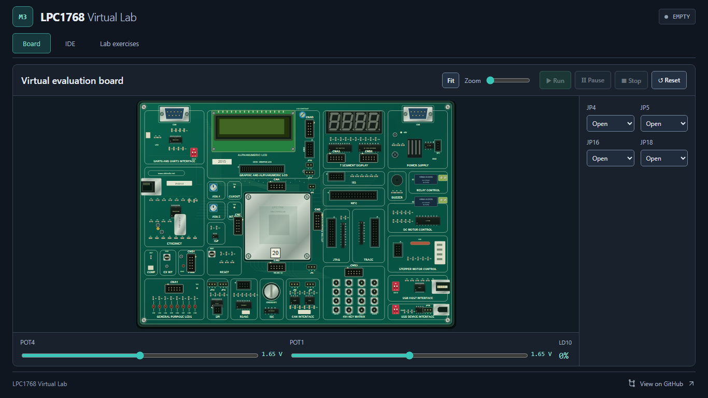
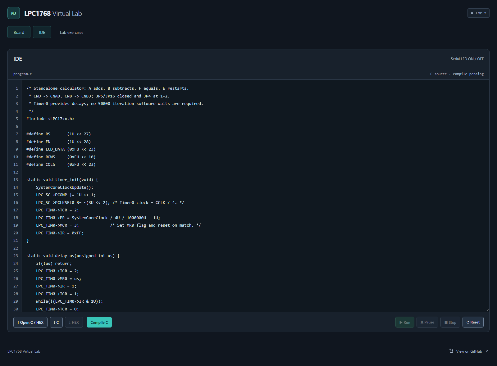

# LPC1768 Virtual Embedded Systems Lab

A local simulator of the ALS-SDA-ARMCTXM3-01 board for Labs 6–11. Run real
Cortex-M3 firmware with Unicorn, connect ribbon cables and jumpers, and experiment
with LEDs, switches, LCD, keypad, seven-segment displays, ADC and PWM.

## Screenshots

| Interactive board | C editor |
| --- | --- |
|  |  |

## Build and run

Requires **Windows**, **Python 3.10+**, and **Node.js 20.19+ or 22.12+**.
To compile C, install **Keil ARM Compiler 5** with LPC17xx CMSIS and startup
files at `C:\Keil\ARM`, or set `KEIL_ARM_ROOT` to your installation's `ARM`
directory. Keil is not bundled; uploading a prebuilt `.hex` works without it.

Run these commands from the repository folder in PowerShell:

```powershell
python -m venv .venv
.\.venv\Scripts\python.exe -m pip install -r requirements.txt
npm.cmd ci
npm.cmd run build
.\.venv\Scripts\python.exe -m simulator.server
```

Open **http://127.0.0.1:8765**. On subsequent runs, double-click `start.bat`;
it also installs missing dependencies and builds the frontend if absent.
Use `stop.bat` to stop a service started by the launcher. After frontend changes,
run `npm.cmd run build` again; after Python changes, restart the service.

Choose a lab, write or upload C/HEX in **IDE**, and connect the required cables
and jumpers on **Board** before running. See the [usage and wiring guide](docs/USAGE.md).

## Development and checks

Keep the backend running and use `npm.cmd run dev` in a second terminal for
frontend development. Backend tests that compile firmware require Keil ARM5.
Browser tests reset the running simulator; use a separate lab session.

```powershell
.\.venv\Scripts\python.exe -m pytest -q
npx.cmd playwright install chromium
npm.cmd run test:browser
```

## Scope

Timers, PWM and ADC use modeled peripheral timing; CPU execution and software
delays depend on host speed. This is a tested digital subset, not a cycle-accurate
or complete LPC1768 replacement. No physical-board equivalence is claimed.

[Lab coverage](docs/LAB_COVERAGE.md) · [Hardware specification](HARDWARE_SPEC.md) ·
[Test report](TEST_REPORT.md) · [Known limitations](HARDWARE_FIDELITY_GAPS.md)
